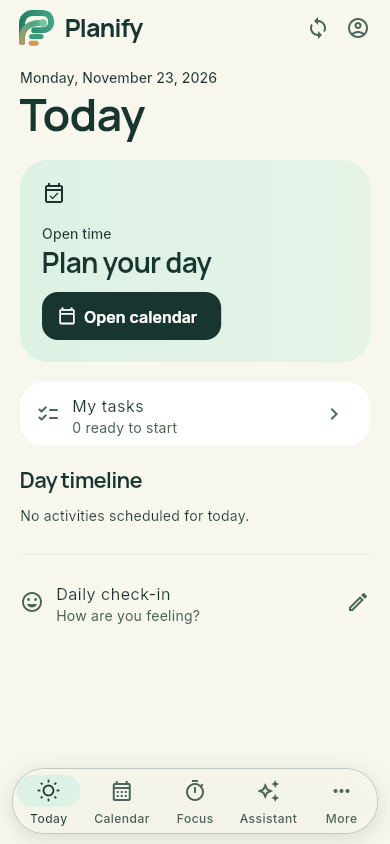
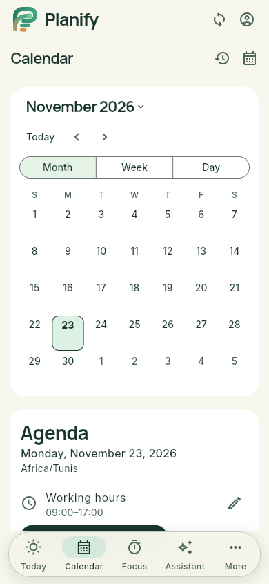
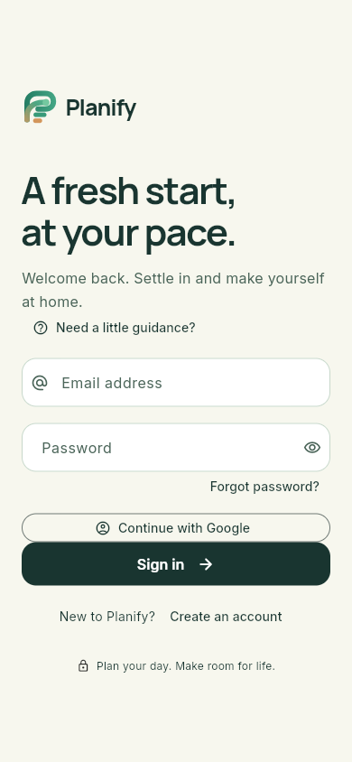

# Planify

**A calmer way to turn plans into progress.**

Planify brings tasks, a real-date calendar, focus sessions, goals, projects, and a conversational assistant into one place. Capture what matters, review a schedule around commitments and breaks, then record the work you actually did. Planify is a Flutter app for Android and iOS, with a web preview for development.



## From intention to a workable day

1. **Capture and break down work.** Create tasks, set prerequisites and recurrence, and review AI-proposed subtasks before saving.
2. **Make time for it.** See month, week, and day views. Add fixed commitments and breaks; generate a schedule proposal that explains placements and unscheduled work. Approve it before your calendar changes.
3. **Follow through.** Start focus from a scheduled task, pause when needed, and record active time. Finishing a focus session does not silently complete its task.
4. **Adjust as life happens.** Report an interruption and review a revised plan. You decide whether to apply it.
5. **Stay in sync.** Account sessions restore after restart. Personal changes can queue offline, with visible sync and conflict recovery when connectivity returns.

| Calendar planning | Account access |
| --- | --- |
|  |  |

## What is available

- **Tasks and next actions:** dependencies, recurring occurrences, breakdown review, and recommendations grounded in task state.
- **Planning and focus:** scheduling around working hours and fixed events, approval and revision history, linked focus sessions, and recorded task activity.
- **Goals and projects:** linked tasks, attributed progress, collaboration, and server-enforced access rules.
- **Account and privacy:** email and password access, Google sign-in on the web preview, secure sessions, preferences, onboarding, offline personal data, and sync conflict review.
- **AI assistance:** conversational help and reviewable actions through a configured OpenRouter free model. Cloud AI requires user consent; provider results and suggestions are never presented as saved actions until confirmed.
- **Google Calendar:** optionally connect an account to view upcoming events and create an event in the primary calendar. These events are currently shown separately from approved Planify plans.

These screenshots were captured from the Flutter web preview at a 390 × 844 phone viewport using a new account on 23 November 2026. Empty states are genuine and progress figures are never sample data.

## Run locally

Requirements: Flutter matching `pubspec.yaml` and Node.js 22.17 or later. Configure `backend/.env` from the relevant [integration notes](docs/PLANIFY_INTEGRATION.md). Production needs a Neon `DATABASE_URL`; local development can use the documented database fallback.

```powershell
npm --prefix backend ci
npm --prefix backend start
```

In another terminal:

```powershell
flutter pub get
flutter run -d chrome --web-port 8052 --dart-define=API_BASE_URL=http://localhost:4100
```

The API listens on port 4100 by default. For Android emulator networking and native release constraints, see [Planify integration](docs/PLANIFY_INTEGRATION.md). Google sign-in currently uses the configured web OAuth client; Android and iOS need their own Google OAuth setup. See [Google integration](docs/GOOGLE_INTEGRATION.md).

## Verify

```powershell
npm --prefix backend run check
npm --prefix backend test
flutter test
flutter analyze
flutter build web --release
```

## Architecture and setup

The Flutter app uses `AppSession` for account identity, session restoration, and authorized API requests. The Node backend stores account and workspace data in Neon when `DATABASE_URL` is configured. It keeps Google OAuth secrets and Calendar tokens off the client; Calendar tokens are encrypted at rest. OpenRouter calls stay on the backend and use free models within the configured daily request budget.

- [Integration and device setup](docs/PLANIFY_INTEGRATION.md)
- [Neon and OpenRouter](docs/NEON_OPENROUTER.md)
- [Google sign-in and Calendar](docs/GOOGLE_INTEGRATION.md)
- [Eya session and personal sync](docs/EYA_SESSION_AND_SYNC.md)
- [Personalized onboarding and sync help](docs/EYA_AI_SETUP.md)
- [Conversational assistant](docs/CONVERSATIONAL_AGENT.md)
- [Brand assets and licenses](assets/branding/README.md)

## Current limits


Google Calendar access requires a configured Google Cloud project and user consent. It does not yet import busy events into Planify's scheduling constraints or export approved plans. Android and iOS Google clients are pending. Email delivery for password recovery is not configured. Sensitive account export and deletion remain gated on the documented policy decision. The local web server is a development preview, not production hosting.

